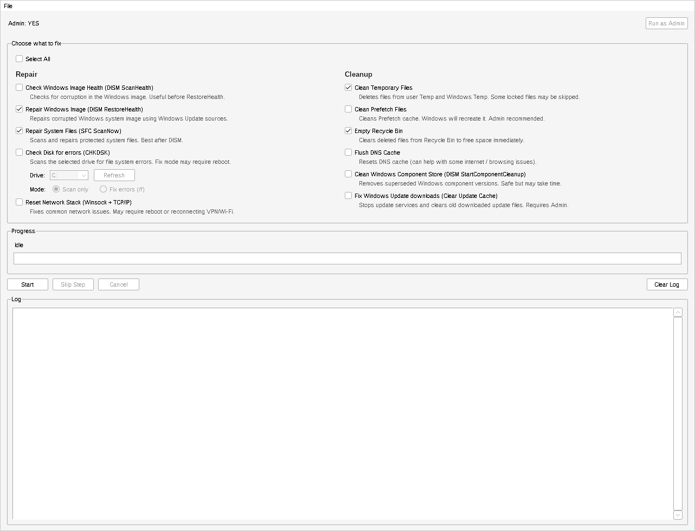

<p align="center">
  
</p>

<h1 align="center">Windows Fixer</h1>

<p align="center">
  <b>Repair and clean up Windows, in one window.</b><br>
  DISM, SFC, CHKDSK, network reset and safe cleanup tools, with a problem finder, a progress bar and a live log. Light and dark themes, English and Arabic.
</p>

<p align="center">
  <a href="../../releases/latest"></a>
  <a href="../../releases/latest"></a>
  
  <a href="LICENSE"></a>
  <a href="../../stargazers"></a>
</p>

<p align="center">
  <a href="https://github.com/ilukezippo/Windows_Fixer/releases/download/v1.2.0/WindowsFixer_v1.2.0.exe"></a>
</p>

<p align="center">
  <sub>Downloads the latest version straight away: one EXE file, nothing to install.</sub>
</p>

<p align="center">
  <a href="../../releases/latest">All downloads</a> ·
  <a href="#how-to-use">How to use</a> ·
  <a href="CHANGELOG.md">What's new</a> ·
  <a href="#what-it-can-fix">What it can fix</a> ·
  <a href="#build-from-source">Build</a>
</p>

<p align="center">
  
</p>

<p align="center"><sub>If Windows Fixer saves you time, a ⭐ star on this page helps other people find it.</sub></p>

---

## Why

When Windows starts misbehaving, the usual advice is a list of commands to type into an administrator Command Prompt: `DISM /RestoreHealth`, `sfc /scannow`, `chkdsk`, `netsh winsock reset`… Windows Fixer puts them all in one window. Describe the problem or let it check your PC and it suggests the right steps; click **Start** and it runs each step in the right order, with a progress bar, a live log, and the option to skip a step or cancel.

## How to use

1. Run **Windows Fixer**. Most steps need administrator rights: click **Run as Admin**, or turn on **Settings → Always run as admin**.
2. Not sure what to run? On the **Diagnose** tab, type what's wrong (for example *"wifi keeps disconnecting"* or *"التحديثات عالقة"*) and click **Suggest fix**, or click **Check for problems**. Then click **Tick suggested steps**.
3. Or tick the steps yourself on the **Repair & Cleanup** tab (or **Select all**). Each one has a short description under it.
4. Click **Start**. The steps run one after another; the progress bar shows the percentage, the **Log** tab shows every command's output, and a summary at the end shows how each step went.

| Do this | You get |
|---|---|
| **Skip Step** | Stops the step that's running and moves on to the next one |
| **Cancel** | Stops everything |
| **Copy Log** / **Save Log…** | The log on the clipboard or in a text file |
| **Clear Log** | An empty log |
| **Settings → Theme** (or the ☾ / ☀ button) | Light, dark, or the same as Windows |
| **Settings → Language** (or the العربية / English button) | English, or Arabic with a right-to-left layout |
| **Settings → Options** | Always run as admin, a restore point before repairs, the check at startup, the sound |
| **Settings → Check for updates** | A new version, if there is one |
| **About** | The version, [more apps](https://ilukezippo.github.io/), the GitHub page and how to report a problem |

Windows Fixer also checks GitHub for a new version when it starts.

## Find the problem

**Describe it.** Type the problem in your own words, in English or Arabic, and Windows Fixer suggests the steps for it: internet trouble → flush DNS and reset the network; a slow PC or a full disk → the cleanups; Windows Update errors → clear the update cache and repair the image; crashes and blue screens → DISM + SFC; drive errors → CHKDSK. It works offline and sends nothing anywhere.

**Check for problems.** A quick, read-only check that runs when the app starts (you can turn that off) and whenever you click the button. It looks at:

- free space on the Windows drive
- the size of temporary files, the Recycle Bin and old Windows Update downloads
- whether Windows is waiting for a restart
- the internet connection and DNS
- the health your disks report
- the Windows image (DISM CheckHealth, when running as admin)

Anything worth fixing is listed with the steps that fix it.

## What it can fix

**Repair**

| Step | Runs | What it does |
|---|---|---|
| Check Windows Image Health | `DISM /Online /Cleanup-Image /ScanHealth` | Checks the Windows image for corruption. Useful before RestoreHealth |
| Repair Windows Image | `DISM /Online /Cleanup-Image /RestoreHealth` | Repairs the Windows image using Windows Update |
| Repair System Files | `sfc /scannow` | Scans and repairs protected system files. Best after DISM |
| Check Disk for errors | `chkdsk C:` or `chkdsk C: /f` | Scans the drive you pick; *Fix errors* may need a restart |
| Reset Network Stack | `netsh winsock reset`, `netsh int ip reset` | Fixes common network problems. May need a restart |

**Cleanup**

| Step | What it does |
|---|---|
| Clean Temporary Files | Deletes files from your Temp folder and Windows Temp (files in use are skipped) |
| Clean Prefetch Files | Clears the Prefetch cache; Windows rebuilds it |
| Empty Recycle Bin | Frees the space right away |
| Flush DNS Cache | `ipconfig /flushdns`, which can help with some internet problems |
| Clean Windows Component Store | `DISM /StartComponentCleanup`: removes superseded Windows components |
| Fix Windows Update downloads | Stops the update services, clears the downloaded update files and starts the services again |

## Features

- **Find the problem**: describe it, or let the app check your PC, and it suggests the steps
- **A restore point** before repairs, so you can undo them
- **Tabs**: Diagnose, Repair & Cleanup, Log, Settings, About
- **Repair and cleanup in one place**, run in a sensible order
- **Progress bar with a percentage** and step tracking and a **full live log** of every command's output
- **Skip** the current step or **cancel** everything at any time
- **Admin detection**, *Run as Admin*, and *Always run as admin*
- **Light and dark themes**, or follow the Windows setting
- **English and Arabic**, with a right-to-left layout in Arabic
- **Updates:** checks this GitHub page for a new version
- A success sound when everything is done

## Install

1. **[Download WindowsFixer_v1.2.0.exe](https://github.com/ilukezippo/Windows_Fixer/releases/download/v1.2.0/WindowsFixer_v1.2.0.exe)** (the latest version), or get it from the [Releases](../../releases/latest) page.
2. Run it. It's a single portable file: nothing is installed.

> The app is not code-signed yet, so Windows may warn about it:
>
> - **Microsoft Edge** may hold the download ("isn't commonly downloaded"): open the downloads list, point at the file, choose **… → Keep**, then **Show more → Keep anyway**.
> - **SmartScreen** may warn when you run it: choose **More info → Run anyway**.

The release notes list the file's SHA-256 if you want to check the download.

**Requirements:** Windows 10 or 11.

## Build from source

You need Python 3.9 or newer.

```bat
git clone https://github.com/ilukezippo/Windows_Fixer.git
cd Windows_Fixer
run.bat      :: first run creates a .venv, installs dependencies, starts the app
build.bat    :: builds dist\windows_fixer.exe
```

Every push to `main` builds the app with GitHub Actions. To publish a release, set `APP_VERSION` in `windows_fixer.py`, add the version to [CHANGELOG.md](CHANGELOG.md), and push a tag like `v1.2.1`: the workflow builds `WindowsFixer_v1.2.1.exe` (one file, with the icon, sound and theme inside), publishes it with that version's changelog, and points the Download buttons on this page at it.

### Project layout

```
windows_fixer.py   the whole app (Tkinter + sv-ttk + Pillow)
icon.ico           app icon
kuwait.png         flag shown in About
Success.wav        sound played when everything finished (built into the EXE)
assets/, shots/    pictures for this page
```

## How it works

- Each ticked step runs a standard Windows command (DISM, SFC, CHKDSK, netsh, ipconfig, net stop/start) or a small built-in cleanup, one after another.
- The output of every command streams into the log as it runs. **Skip** and **Cancel** stop the running command.
- Your language, theme, ticked steps and *Always run as admin* choice are saved in `%APPDATA%\WindowsFixer\settings.json`. See the [privacy policy](PRIVACY.md).

## Known limits

- Most repair steps need administrator rights.
- DISM RestoreHealth needs Windows Update to be reachable.
- CHKDSK's *Fix errors* on the Windows drive, and the network reset, take effect after a restart.

## License

[MIT](LICENSE) © ilukezippo
